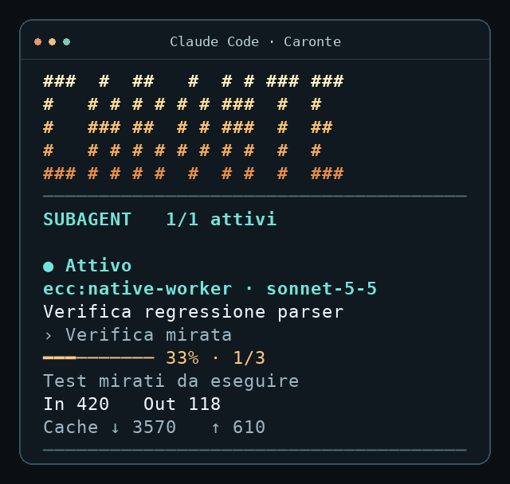
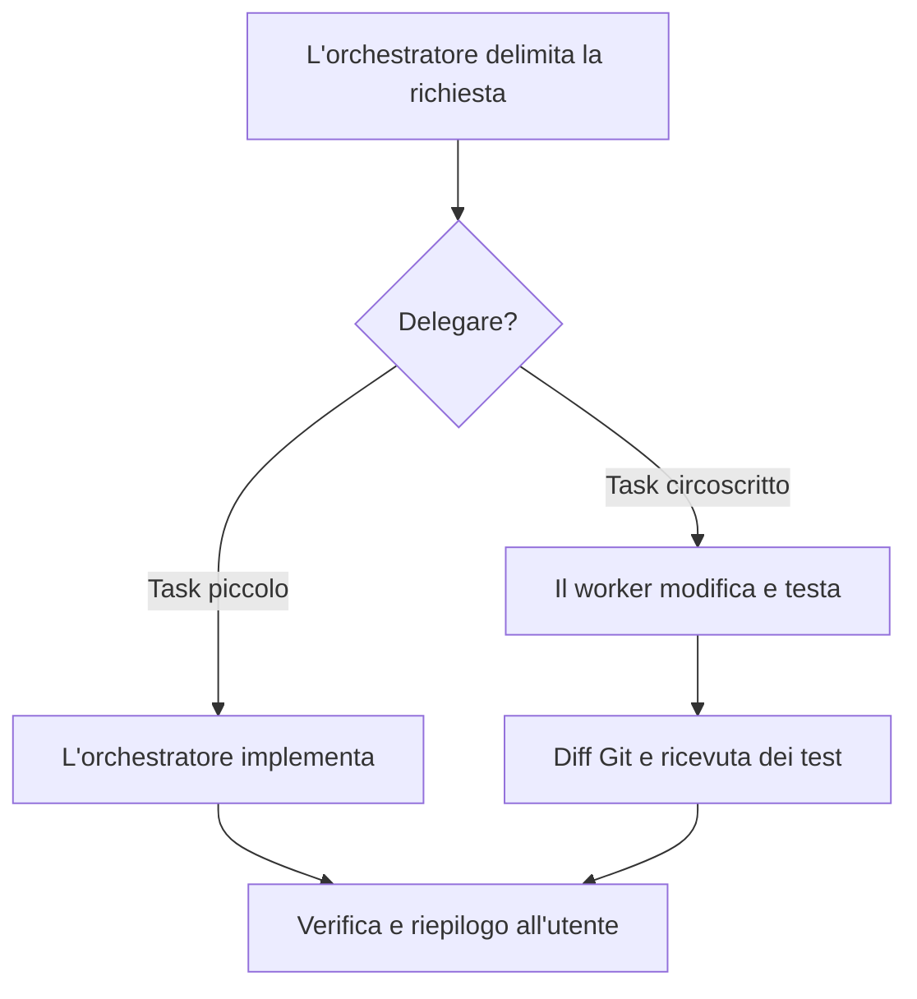

<div align="center">

[English](README.md) · Italiano

# Caronte

### Delega a Claude Code con fiducia.<br>Accetta solo ciò che il diff Git dimostra.

**Un kit di orchestrazione e verifica per Claude Code, limitato al singolo progetto.**

[Inizia in 2 minuti](#inizia) · [Come funziona](#come-funziona) · [Leggi la documentazione](#documentazione)



</div>

---

## Il problema

Gli agenti AI scrivono codice in fretta. Fidarsi del risultato è la parte lenta.

- Un worker dice «fatto», ma i test sono stati davvero eseguiti sui file modificati?
- Una delega va fuori strada perché il brief mancava di contesto, o ne portava troppo.
- I log verbosi di build e test inondano la conversazione.
- Un task lungo muore con la sessione e si ricomincia da zero.

## La risposta di Caronte

Caronte trasforma Claude Code in un team disciplinato: un coordinatore che delimita il lavoro, specialisti che lo eseguono e una verifica che **non si fida mai della parola di un worker**.

> **Delega un task con il contesto strettamente necessario. Esegui i test pertinenti. Leggi il vero diff Git. Poi accetta.**

---

## Perché i team scelgono Caronte

### Deleghe che restano sull'obiettivo
Ogni delega porta un brief breve e validato: obiettivo, input, fatti, vincoli, uscita e verifica di accettazione. Modello e specialista sono scelti in base al lavoro, e i task piccoli o deterministici restano all'orchestratore invece di essere delegati senza motivo.

### Prove, non promesse
L'orchestratore cattura una baseline Git prima che il worker parta. Il worker modifica solo i file dichiarati ed esegue solo i test mirati del suo piano. Poi l'orchestratore legge il **diff reale** e confronta la **ricevuta dei test** con i file correnti. Una ricevuta mancante o obsoleta lascia il controllo aperto. La suite completa è riservata all'orchestratore, dopo la revisione.

### Specialisti a disposizione
Caronte include specialisti [ECC](https://github.com/affaan-m/ECC) selezionati: guida TDD, risolutori di errori di build per JS/TS e Java, e revisori mirati per Java, C#, TypeScript e rischi trasversali. I worker hanno un perimetro definito e le escalation ripetute richiedono nuove evidenze.

### Un lavoro che sopravvive alla sessione
Le fasi ICM registrano dipendenze e output. Alla ripresa, Caronte mostra l'obiettivo, l'ultima evidenza valida, cosa è cambiato e il prossimo passo, poi riparte dalla prima fase che richiede ancora lavoro.

### Una finestra di contesto più silenziosa
RTK filtra l'output shell supportato e Caronte accorcia i log verbosi di test e build prima che arrivino a Claude. Le finestre di auto-compact sono configurate a 200k per la sessione principale e 100k per i worker inclusi. Il tuo comando di avvio Headroom continua a gestire la compressione del contesto lato richiesta. Sono controlli sul contesto, non limiti di spesa.

### Tutto sotto controllo, in tempo reale
Un pannello laterale dentro Claude Code mostra l'attività dei subagent in corso e completata, i totali di progetto per token di input, output, cache-read e cache-write, e il costo stimato in USD riportato da Claude Code. Chiudere la sessione non fa perdere nulla: Caronte ripristina l'attività registrata localmente quando riapri il progetto.

---

## Come funziona



| Passo | Cosa succede |
| --- | --- |
| **1. Brief** | L'orchestratore prepara un brief validato con perimetro, input, fatti, uscita e verifica di accettazione. |
| **2. Baseline** | Vengono catturati una baseline Git e un piano di test con i file esatti e i test pertinenti. |
| **3. Esecuzione** | Un worker modifica i file dichiarati ed esegue solo i comandi mirati. |
| **4. Revisione** | L'orchestratore legge il diff Git, inclusi i test modificati, e controlla la ricevuta dei test rispetto agli input correnti. |
| **5. Consegna** | Ricevi l'effetto concreto, i file cambiati, l'esito verificato dei test mirati e quello della suite completa, oppure un esplicito «non eseguita». |

La chat principale riporta avanzamento utile, cosa è cambiato, cosa è stato verificato e cosa resta aperto. Brief, log e misurazioni restano consultabili quando servono.

### Compatibile con il tuo stack

Node.js, Vitest, Jest, pytest, .NET (con filtri VSTest), Maven e Gradle. Ogni piano di test indica il file o il selettore interessato e il motivo per cui rientra nel perimetro. Runtime e dipendenze di test sono forniti dal tuo progetto. Vedi [consegna e revisione](.claude/routing/CONSEGNA.md) per selettori e limiti delle capacità.

---

## Inizia

**Requisiti:** Git, Node.js 22+, Python 3.11+ e Claude Code 2.1.327+. La prima installazione scarica le dipendenze da GitHub e dal Python Package Index. Su Windows, RTK viene installato tramite WinGet se manca.

### Opzione 1: la CLI di Caronte (consigliata)

Registra il comando `caronte` una volta, da un clone permanente. Su Windows, per esempio:

```powershell
git clone https://github.com/manuel-albanesee/Caronte.git C:\git\Caronte
Set-Location C:\git\Caronte
npm link
```

Poi, nella radice di ogni progetto da equipaggiare:

```powershell
caronte install-project
```

Il comando installa Caronte, ECC, Headroom e RTK nella directory corrente. Per un'anteprima usa `caronte install-project --dry-run`, per un controllo `caronte install-project --verify`, e avvia Claude Code con `caronte start`.

### Opzione 2: lascia che sia Claude Code a installarlo

Apri Claude Code nel progetto di destinazione e incolla il [prompt di auto-installazione](INSTALL_PROMPT.md). L'agente ispeziona Caronte in una directory temporanea, mostra in anteprima le modifiche al progetto, installa e verifica il risultato. Poi avvia una nuova sessione.

### Opzione 3: da terminale

Clona Caronte **fuori dal progetto di destinazione** ed esegui i comandi dal checkout, sostituendo `<project-root>` con il percorso del worktree di destinazione (PowerShell, macOS e Linux):

```sh
git clone https://github.com/manuel-albanesee/Caronte.git
cd Caronte
node install.cjs "<project-root>" --dry-run
node install.cjs "<project-root>"
node install.cjs "<project-root>" --verify
```

Tieni `.claude/settings.local.json` e `.claude-routing-backups/` fuori dal controllo di versione. Poi avvia Claude Code dal worktree di destinazione e usa `/agents` e `/hooks` per vedere cosa ha caricato la sessione. I normali permessi di Claude Code restano validi.

L'installer scarica la release completa di ECC in `.claude/skills/ecc/` e abilita il suo plugin nativo di Claude Code, preservando un'eventuale registrazione da marketplace. Riusa una CLI Headroom funzionante nel PATH, altrimenti la scarica in `.claude/vendor/headroom/` con la sua CLI proxy nella `.venv` del checkout. RTK usa per impostazione predefinita il modulo GateGuard del checkout ECC. Vedi la [guida all'installazione](GUIDA.md#installazione).

### Resta aggiornato in automatico

Dal clone permanente, abilita una volta gli aggiornamenti automatici per il tuo utente Claude Code. Questo registra un hook `SessionStart` nelle impostazioni utente:

```sh
node install.cjs --enable-auto-update
```

Dopo, ti basta `git pull --ff-only` nel clone di Caronte. La prossima volta che avvii o riprendi Claude Code in un progetto o worktree installato, Caronte aggiorna i propri file gestiti se il clone ha una revisione più recente. Vedi la [guida all'aggiornamento automatico](GUIDA.md#aggiornamento-automatico-di-caronte).

---

## Il pannello subagent in tempo reale

Avvia `claude` dalla radice di un worktree attendibile con Caronte installato. Il pannello si carica con il progetto e si apre da solo quando il terminale ha abbastanza spazio.

- `/tui fullscreen` offre la barra laterale a destra, e `/caronte-panel` la attiva o disattiva, anche nei terminali stretti.
- Il pannello dedica il 20% dell'altezza al logo e al link GitHub, il 60% all'attività dei subagent in corso e completata, e il 20% ai totali di progetto.
- **↑** / **↓**, oppure `/caronte-panel prev` e `/caronte-panel next`, scorrono i dettagli dei subagent e i checkpoint di Caronte.
- **ASCII**, oppure `/caronte-panel ascii`, apre l'artwork originale. Spostati con **←** / **→** e seleziona **Subagent** per tornare indietro.

*Testato con Claude Code 2.1.327. Vedi la [guida al pannello](GUIDA.md#pannello-subagent-in-claude-code).*


---

## Trasparenza

- Caronte **non dichiara risparmi di token misurati**, perché il prodotto è ancora in piena fase di test. I dati sui token sono mostrati solo se misurati, con il relativo perimetro.
- Gli hook del progetto coprono i tool di Claude Code registrati. Impostazioni gestite, sandbox e altri tool possono influire sul comportamento a runtime.
- La telemetria locale parte alla prima apertura o ripresa con Caronte e resta sulla tua macchina. Esegui `/caronte-telemetry-off` per fermarla nel worktree corrente e `/caronte-telemetry-on` per riattivarla. Esegui `node .claude/routing/telemetry.cjs dashboard` per aprire una dashboard locale con riletture dopo modifiche ai file, uso delle API e filtraggio dell'output di test e build. Vedi la [guida alla telemetria](TELEMETRY.md).

---

## Documentazione

```sh
node --test tests/*.test.cjs
```

- [Guida utente italiana](GUIDA.md)
- [Telemetria locale, controlli e campi dati](TELEMETRY.md)
- [Dipendenze e comportamento degli aggiornamenti](DIPENDENZE.md)
- [Registro delle verifiche e copertura residua](VERIFICA.md)
- [Fasi ICM e ripristino](.claude/routing/ICM.md)
- [Consegna e revisione](.claude/routing/CONSEGNA.md)
- [Avvisi su componenti di terze parti](NOTICE.md)
- [Politica sui contributi](CONTRIBUTING.md)

---

## Licenza

Il materiale originale di Caronte è di proprietà di **Manuel Albanese** e usa la [Caronte Source-Available License v2.0](LICENSE).

- **Gratuito:** sviluppo, test e CI/CD dei prodotti che vendi.
- **A pagamento:** eseguire Caronte come parte di un prodotto o servizio a pagamento richiede una licenza commerciale di runtime separata da [Manuel Albanese](https://github.com/manuel-albanesee).

Se usi Caronte per sviluppare un progetto, includi questo riconoscimento nel README, nei credits o nella documentazione equivalente di quel progetto. I progetti privati possono mantenerlo privato.

> Developed with [Caronte](https://github.com/manuel-albanesee/Caronte) by Manuel Albanese (@manuel-albanesee).

I materiali MIT inclusi mantengono le rispettive licenze. Vedi [NOTICE.md](NOTICE.md).

## Crediti

- **Jake Van Clief**, creatore di [ICM Architect](https://github.com/RinDig/icm-architect), e **Jake Van Clief e David McDermott**, autori dell'[articolo su ICM](https://arxiv.org/abs/2603.16021).
- **Affaan Mustafa** e i [contributori di ECC](https://github.com/affaan-m/ECC) per i profili degli specialisti.
- I [contributori di RTK](https://github.com/rtk-ai/rtk) per il filtraggio dell'output shell.
