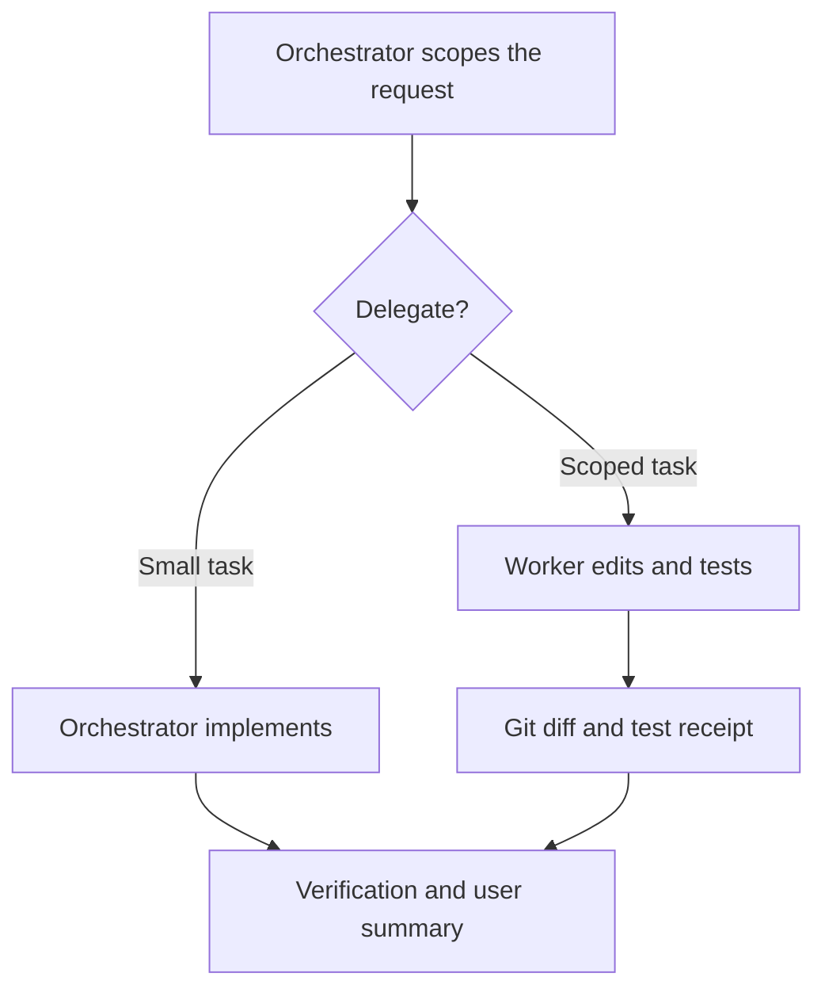

<div align="center">

English · [Italiano](README.it.md)

# Caronte

### Delegate to Claude Code with confidence.<br>Accept only what the Git diff proves.

**A project-scoped orchestration and verification kit for Claude Code.**

[Get started in 2 minutes](#get-started) · [See how it works](#how-it-works) · [Read the docs](#documentation)


</div>

---

## The problem

AI agents write code fast. Trusting it is the slow part.

- A worker says "done", but did the tests actually run on the files that changed?
- A delegation drifts because the brief lacked context, or carried far too much of it.
- Verbose build and test logs flood the conversation.
- A long task dies with the session, and you restart from zero.

## The Caronte answer

Caronte turns Claude Code into a disciplined team: a coordinator that scopes the work, specialists that execute it, and a verification step that **never takes a worker's word for it**.

> **Delegate a task with just enough context. Run the relevant tests. Review the real Git diff. Then accept.**

---

## Why teams choose Caronte

### Delegation that stays on target
Every delegation carries a short, validated brief: goal, inputs, facts, constraints, deliverable and acceptance check. The right model and specialist are chosen for the job, and small or deterministic tasks stay with the orchestrator instead of being delegated for nothing.

### Proof, not promises
The orchestrator captures a Git baseline before a worker starts. The worker edits only declared files and runs only the targeted tests in its plan. Afterwards, the orchestrator reads the **actual diff** and checks the **test receipt** against the current files. A stale or missing receipt keeps the check open. The full suite is reserved for the orchestrator, after review.

### Specialists on call
Caronte bundles selected [ECC](https://github.com/affaan-m/ECC) specialists: TDD guide, build-error resolvers for JS/TS and Java, and focused reviewers for Java, C#, TypeScript and cross-cutting risks. Workers have bounded scope, and repeated escalations need new evidence.

### Work that survives the session
ICM stages record their dependencies and outputs. When you resume, Caronte shows the goal, the last valid evidence, what changed and the next step, then picks up at the first stage that still needs work.

### A quieter context window
RTK filters supported shell output, and Caronte shortens verbose test and build logs before they reach Claude. Auto-compact windows are configured at 200k for the main session and 100k for bundled workers. Your existing Headroom launch command keeps handling request-side context compression. These are context controls, not spending limits.

### See everything, live
A sidebar panel inside Claude Code shows live and completed subagent activity, project totals for input, output, cache-read and cache-write tokens, and the estimated USD cost reported by Claude Code. Closing the session doesn't lose it: Caronte restores the locally recorded activity when you reopen the project.

---

## How it works



| Step | What happens |
| --- | --- |
| **1. Brief** | The orchestrator prepares a validated brief with scope, inputs, facts, deliverable and acceptance check. |
| **2. Baseline** | A Git baseline and a test plan with the exact files and the relevant tests are captured. |
| **3. Execute** | A worker edits the declared files and runs only the targeted commands. |
| **4. Review** | The orchestrator reads the Git diff, including modified tests, and checks the test receipt against current inputs. |
| **5. Deliver** | You get the concrete effect, the files that changed, the verified targeted tests and the full-suite result, or an explicit "not run". |

The main chat reports useful progress, what changed, what was verified and what remains open. Briefs, logs and measurements stay available whenever you want them.

### Works with your stack

Node.js, Vitest, Jest, pytest, .NET (VSTest filtering), Maven and Gradle. Each test plan names the affected file or selector and why it is in scope. Runtimes and test dependencies come from your project. See [delivery and review](.claude/routing/CONSEGNA.md) for selectors and capability boundaries.

---

## Get started

**Requirements:** Git, Node.js 22+, Python 3.11+ and Claude Code 2.1.327+. The first install fetches dependencies from GitHub and the Python package index. On Windows, RTK is installed through WinGet if it is missing.

### Option 1: the Caronte CLI (recommended)

Register the `caronte` command once from a permanent clone. On Windows, for example:

```powershell
git clone https://github.com/manuel-albanesee/Caronte.git C:\git\Caronte
Set-Location C:\git\Caronte
npm link
```

Then, in the root of each project you want to equip:

```powershell
caronte install-project
```

This installs Caronte, ECC, Headroom and RTK in the current directory. Preview it with `caronte install-project --dry-run`, check it with `caronte install-project --verify`, and launch Claude Code with `caronte start`.

### Option 2: let Claude Code install it

Open Claude Code in the target project and paste the [self-install prompt](INSTALL_PROMPT.md). The agent inspects Caronte in a temporary directory, previews the project changes, installs and verifies the result. Start a fresh session afterwards.

### Option 3: from a terminal

Clone Caronte **outside the target project** and run from the checkout, replacing `<project-root>` with the target worktree path (PowerShell, macOS and Linux):

```sh
git clone https://github.com/manuel-albanesee/Caronte.git
cd Caronte
node install.cjs "<project-root>" --dry-run
node install.cjs "<project-root>"
node install.cjs "<project-root>" --verify
```

Keep `.claude/settings.local.json` and `.claude-routing-backups/` out of version control. Then start Claude Code from the target worktree and use `/agents` and `/hooks` to see what the session loaded. Your normal Claude Code permissions still apply.

The installer downloads the full ECC release into `.claude/skills/ecc/` and enables its native Claude Code plugin, preserving an existing marketplace registration. It reuses a working Headroom CLI on PATH, or otherwise downloads it into `.claude/vendor/headroom/` with its proxy CLI in the checkout's `.venv`. RTK uses the GateGuard module from the ECC checkout by default. See the [installation guide](GUIDA.md#installazione).

### Stay up to date automatically

From the permanent clone, enable automatic updates once for your Claude Code user. This registers a `SessionStart` hook in your user settings:

```sh
node install.cjs --enable-auto-update
```

After that, `git pull --ff-only` in the Caronte clone is all you do. The next time you start or resume Claude Code in an installed project or worktree, Caronte updates its managed files if the clone has a newer revision. See the [automatic update guide](GUIDA.md#aggiornamento-automatico-di-caronte).

---

## The live subagent panel

Start `claude` from the root of a trusted worktree with Caronte installed. The panel loads with the project and opens automatically when the terminal has enough space.

- `/tui fullscreen` gives you the right-hand sidebar, and `/caronte-panel` toggles it, even in narrow terminals.
- The pane gives 20% of its height to the logo and GitHub link, 60% to live and completed subagent activity, and 20% to project totals.
- **↑** / **↓**, or `/caronte-panel prev` and `/caronte-panel next`, page through subagent details and Caronte checkpoints.
- **ASCII**, or `/caronte-panel ascii`, opens the original artwork. Pan with **←** / **→**, and select **Subagent** to go back.

*Tested with Claude Code 2.1.327. See the [panel guide](GUIDA.md#pannello-subagent-in-claude-code).*


---

## Honest by design

- Caronte makes **no measured token-savings claim**, because the product is still in an active testing phase. Token figures are shown only when measured, with their scope.
- Project hooks cover the registered Claude Code tools. Managed settings, sandboxing and other tools may affect runtime behavior.
- Local telemetry starts on the first startup or resume with Caronte, and it stays on your machine. Run `/caronte-telemetry-off` to stop it for the current worktree and `/caronte-telemetry-on` to restart it. Run `node .claude/routing/telemetry.cjs dashboard` to open a local dashboard of rereads after file changes, API usage, and test and build output filtering. See the [telemetry guide](TELEMETRY.md).

---

## Documentation

```sh
node --test tests/*.test.cjs
```

- [Italian user guide](GUIDA.md)
- [Local telemetry, controls and data fields](TELEMETRY.md)
- [Dependency and update behavior](DIPENDENZE.md)
- [Verification record and remaining coverage](VERIFICA.md)
- [ICM stages and recovery](.claude/routing/ICM.md)
- [Delivery and review](.claude/routing/CONSEGNA.md)
- [Third-party notices](NOTICE.md)
- [Contribution policy](CONTRIBUTING.md)

---

## License

Caronte's original material is owned by **Manuel Albanese** and uses the [Caronte Source-Available License v2.0](LICENSE).

- **Free:** development, testing and CI/CD of the products you sell.
- **Paid:** running Caronte as part of a paid product or service requires a separate commercial runtime license from [Manuel Albanese](https://github.com/manuel-albanesee).

If you use Caronte to develop a project, include this credit in that project's README, credits or equivalent documentation. Private projects can keep the credit private.

> Developed with [Caronte](https://github.com/manuel-albanesee/Caronte) by Manuel Albanese (@manuel-albanesee).

Bundled MIT materials retain their respective licenses. See [NOTICE.md](NOTICE.md).

## Credits

- **Jake Van Clief**, creator of [ICM Architect](https://github.com/RinDig/icm-architect), and **Jake Van Clief and David McDermott**, authors of the [ICM paper](https://arxiv.org/abs/2603.16021).
- **Affaan Mustafa** and the [ECC contributors](https://github.com/affaan-m/ECC) for the specialist profiles.
- The [RTK contributors](https://github.com/rtk-ai/rtk) for shell output filtering.
