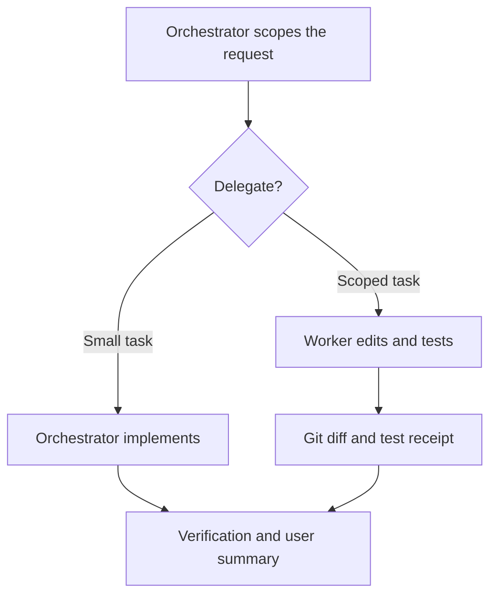

# Caronte

**A project-scoped orchestration and verification kit for Claude Code.**

Delegate a task with just enough context, run the relevant application tests, and review the actual Git diff before accepting the change.

Caronte combines model routing, selected ECC specialists, focused test plans, and resumable ICM workflows. RTK filters supported shell output. Caronte also shortens verbose test and build logs before they reach Claude. An existing Headroom launch command can keep handling request-side context compression.

## Quick start

**Requirements:** Git, Node.js 22+, and Claude Code 2.1.296+. Use the root of the Git worktree you want to configure. RTK is reused when detected, or installed through a supported package manager.

### Install from Claude Code

Open Claude Code in the target project, then copy the [self-install prompt](INSTALL_PROMPT.md) into that session. The agent clones and inspects Caronte in a temporary directory, previews the project changes, installs, and verifies the resulting files. Start a fresh Claude Code session afterward.

### Install from a terminal

Clone Caronte **outside the target project** and run these commands from the Caronte checkout. Replace `<project-root>` with the target worktree path. The commands work in PowerShell and shells on macOS and Linux.

```sh
git clone https://github.com/manuel-albanesee/Caronte.git
cd Caronte
node install.cjs "<project-root>" --dry-run
node install.cjs "<project-root>"
node install.cjs "<project-root>" --verify
```

`--dry-run` previews the changes and RTK plan. `--verify` checks whether the installed files match the kit and whether the RTK hook is detected. The installer writes a backup when changing an existing setup. Keep `.claude/settings.local.json` and `.claude-routing-backups/` out of version control in your project.

Start Claude Code from the target worktree. Use `/agents` and `/hooks` to see what the new session loaded. Your normal Claude Code permissions still apply.

If the project uses the full native ECC plugin, run the installer with
`--ecc-full`. Caronte scopes its delegation protocol to its own profiles
and explicit Caronte plans while the ECC plugin runs its full workflows.
See [ECC completo e Caronte](GUIDA.md#ecc-completo-e-caronte) for setup.

## How it works

| Feature | What you get |
| --- | --- |
| **Model routing** | A short, validated brief provides the selected agent with its scope, inputs, facts, deliverable, and acceptance check. |
| **Scoped execution** | The orchestrator captures a Git baseline. A worker edits declared files and runs only the targeted commands in its test plan. |
| **Evidence-based review** | The orchestrator reads the Git diff and checks the test receipt against current inputs. The full suite is reserved for the orchestrator after review. |
| **Context controls** | Configured auto-compact windows of 200k for the main session and 100k for bundled workers, plus selective reads and RTK output filtering. These are context settings, not spending limits. |
| **Resumable stages** | ICM contracts record dependencies and outputs so a new session can find the first stage that needs work. |
| **Launch updates** | Compatible ECC references and package-managed RTK are checked on session start or resume. Cached references remain available offline. |



The main chat reports useful progress, what changed, what was verified, and what remains open. The underlying briefs, logs, and measurements are available when needed.

## Supported test plans

Node.js, Vitest, Jest, pytest, .NET with VSTest filtering, Maven, and Gradle. The test plan names the affected file or selector and the reason it belongs in scope. Runtimes and project test dependencies are supplied by the target project. See [delivery and review](.claude/routing/CONSEGNA.md) for selectors and capability boundaries.

## Verification and documentation

```sh
node --test tests/routing.test.cjs tests/telemetry.test.cjs
```

- [Italian user guide](GUIDA.md)
- [Local telemetry, controls and data fields](TELEMETRY.md)
- [Dependency and update behavior](DIPENDENZE.md)
- [Verification record and remaining coverage](VERIFICA.md)
- [ICM stages and recovery](.claude/routing/ICM.md)
- [Third-party notices](NOTICE.md)

The project hooks cover the registered Claude Code tools. Managed settings, sandboxing, and other tools may affect runtime behavior. Caronte makes no measured token-savings claim.

## Local telemetry

Local telemetry starts automatically on the first Claude Code startup or
resume with Caronte. Run `/caronte-telemetry-off` to stop it for the current
worktree, or `/caronte-telemetry-on` to turn it back on.
Run `node .claude/routing/telemetry.cjs dashboard` from the installed worktree
and open the HTML path it prints. The local dashboard shows rereads after
detected file changes, API usage, and test and build output filtering.
See the [telemetry guide](TELEMETRY.md) for coverage and controls.

## License and attribution

Caronte's original material is owned by **Manuel Albanese** and uses the
[Caronte Source-Available License v2.0](LICENSE). Development, testing, and
CI/CD of products you sell are permitted under the free grant. Running
Caronte as part of a paid product or service requires a separate paid
commercial runtime license from [Manuel Albanese](https://github.com/manuel-albanesee).

If you use Caronte to develop a project, include this credit in that
project's README, credits, or equivalent documentation. Private projects can
keep the credit private.

> Developed with [Caronte](https://github.com/manuel-albanesee/Caronte) by Manuel Albanese (@manuel-albanesee).

Bundled MIT materials retain their respective licenses. See [NOTICE.md](NOTICE.md) and the [contribution policy](CONTRIBUTING.md).

## Credits

- **Jake Van Clief**, creator of [ICM Architect](https://github.com/RinDig/icm-architect), and **Jake Van Clief and David McDermott**, authors of the [ICM paper](https://arxiv.org/abs/2603.16021).
- **Affaan Mustafa** and the [ECC contributors](https://github.com/affaan-m/ECC) for the specialist profiles.
- The [RTK contributors](https://github.com/rtk-ai/rtk) for shell output filtering.
