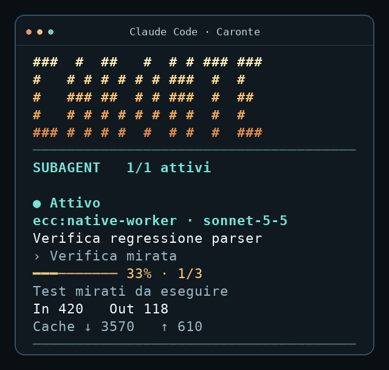
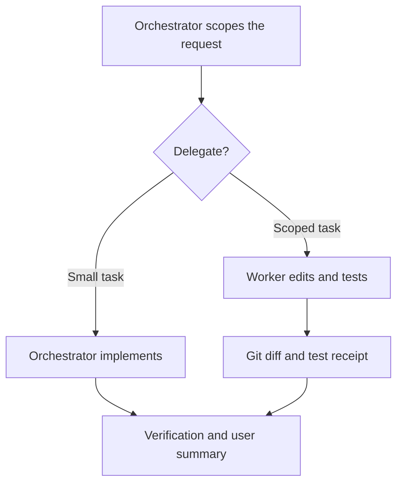

# Caronte

**A project-scoped orchestration and verification kit for Claude Code.**

Delegate a task with just enough context, run the relevant application tests, and review the actual Git diff before accepting the change.

Caronte combines model routing, selected ECC specialists, focused test plans, and resumable ICM workflows. RTK filters supported shell output. Caronte also shortens verbose test and build logs before they reach Claude. An existing Headroom launch command can keep handling request-side context compression.

## Quick start

**Requirements** include Git, Node.js 22+, Python 3.11+, and Claude Code 2.1.327+. The first install fetches dependencies from GitHub and the Python package index. On Windows, RTK uses WinGet if it is missing.

### Install with the Caronte CLI

Register the `caronte` command once from a permanent Caronte clone. On Windows, for example:

```powershell
git clone https://github.com/manuel-albanesee/Caronte.git C:\git\Caronte
Set-Location C:\git\Caronte
npm link
```

If you already have a clone, update it and run `npm link` there. Then open a terminal in the root of each project you want to configure and run:

```powershell
caronte install-project
```

The command uses the current directory and installs Caronte, ECC, Headroom, and RTK. Run `caronte install-project --dry-run` to preview the setup or `caronte install-project --verify` to check it. The command uses the linked clone, so `git pull --ff-only` there updates its source for future installations.

Use `caronte start` from the project root to launch Claude Code through the selected Headroom executable. Interactive installs and launches show the Caronte ASCII logo. Installs also show the current phase and native downloader progress.

### Install from Claude Code

Open Claude Code in the target project, then copy the [self-install prompt](INSTALL_PROMPT.md) into that session. The agent clones and inspects Caronte in a temporary directory, previews the project changes, installs, and verifies the resulting files. Start a fresh Claude Code session afterward.

### Install from a terminal

Clone Caronte **outside the target project** and run these commands from the Caronte checkout. Replace `<project-root>` with the target worktree path. The commands work in PowerShell and shells on macOS and Linux.

```sh
git clone https://github.com/manuel-albanesee/Caronte.git
cd Caronte
node install.cjs "<project-root>" --dry-run
node install.cjs "<project-root>"
node install.cjs "<project-root>" --verify
```

`--dry-run` previews the checkout and runtime setup. `--verify` checks the kit, the ECC checkout, the Headroom runtime, and the GateGuard/RTK hook. Keep `.claude/settings.local.json` and `.claude-routing-backups/` out of version control in your project.

Start Claude Code from the target worktree. Use `/agents` and `/hooks` to see what the new session loaded. Your normal Claude Code permissions still apply.

The installer downloads the full ECC release into `.claude/skills/ecc/` and
enables its native Claude Code plugin. If the project already enables ECC from
a marketplace, Caronte preserves that registration. Caronte reuses a working
Headroom CLI on PATH. When needed, it downloads Headroom into
`.claude/vendor/headroom/` and installs its proxy CLI in the checkout's `.venv`.
RTK uses the GateGuard module from the ECC checkout by
default. See the [installation guide](GUIDA.md#installazione).

### Update installed projects from one checkout

From the permanent Caronte clone, enable automatic updates once for your Claude
Code user. This registers a `SessionStart` hook in your user settings.

```sh
node install.cjs --enable-auto-update
```

After that, run `git pull --ff-only` only in the Caronte clone. The next time
you start or resume Claude Code in an installed project or worktree, Caronte
updates its managed files if the clone has a newer Git revision. Existing
installations are recognized on the first launch. See the
[automatic update guide](GUIDA.md#aggiornamento-automatico-di-caronte).

### Live subagent panel



*Sidebar reopened in Claude Code after a test session with simulated token usage.*

<details open>
<summary>Caronte ASCII artwork</summary>

```text
@@@@@@@@@@@@@@@@@@@@@@@@@@@@@@@@@@@@@@@@@@@@@@@@@@@@@@@@@@@@@@@@@@@@@@@@@@@@@@@@@@@@@@@@@@@@@@@@@@@@@@@@@@@@@@@@@@@@@@@@@@@@@@@@@@@@@@@@@@@@@@@@@@@@@@@@@@@@@@@@@@@@@@@@@@@@@@@@@@@@@@@@@@@@@@@@@@@@@@@@
@@@@@@@@@@@@@@@@@@@@@@@@@@@@@@@@@@@@@@@@@@@@@@@@@@@@@@@@@@@@@@@@@@@@@@@@@@@@@@@@@@@@@@@@@@@@@@@@@@@@@@@@@@@@@@@@@@@@@@@@@@@@@@@@@@@@@@@@@@@@@@@@@@@@@@@@@@@@@@@@@@@@@@@@@@@@@@@@@@@@@@@@@@@@@@@@@@@@@@@@
@@@@@@@@@@@@@@@@@@@@@@@@@@@@@@@@@@@@@@@@@@@@@@@@@@@@@@@@@@@@@@@@@@@@@@@@@@@@@@@@@@@@@@@@@@@@@@@@@@@@@@@@@@@@@@@@@@@@@@@@@@@@@@@@@@@@@@@@@@@@@@@@@@@@@@@@@@@@@@@@@@@@@@@@@@@@@@@@@@@@@@@@@@@@@@@@@@@@@@@@
@@@@@@@@@@@@@@@@@@@@@@@@@@@@@@@@@@@@@@@@@@@@@@@@@@@@@@@@@@@@@@@@@@@@@@@@@@@@@@@@@@@@@@@@@@@@@@@@@@@@@@@@@@@@@@@@@@@@@@@@@@@@@@@@@@@@@@@@@@@@@@@@@@@@@@@@@@@@@@@@@@@@@@@@@@@@@@@@@@@@@@@@@@@@@@@@@@@@@@@@
@@@@@@@@@@@@@@@@@@@@@@@@@@@@@@@@@@@@@@@@@@@@@@@@@@@@@@@@@@@@@@@@@@@@@@@@@@@@@@@@@@@@@@@@@@@@@@@@@@@@@@@@@@@@@@@@@@@@@@@@@@@@@@@@@@@@@@@@@@@@@@@@@@@@@@@@@@@@@@@@@@@@@@@@@@@@@@@@@@@@@@@@@@@@@@@@@@@@@@@@
@@@@@@@@@@@@@@@@@@@@@@@@@@@@@@@@@@@@@@@@@@@@@@@@@@@@@@@@@@@@@@@@@@@@@@@@@@@@@@@@@@@@@@@@@@@@@@@@@@@@@@@@@@@@@@@@@@@@@@@@@@@@@@@@@@@@@@@@@@@@@@@@@@@@@@@@@@@@@@@@@@@@@@@@@@@@@@@@@@@@@@@@@@@@@@@@@@@@@@@@
@@@@@@@@@@@@@@@@@@@@@@@@@@@@@@@@@@@@@@@@@@@@@@@@@@@@@@@@@@@@@@@@@@@@@@@@@@@@@@@@@@@@@@@@@@@@@@@@@@@@@@@@@@@@@@@@@@@@@@@@@@@@@@@@@@@@@@@@@@@@@@@@@@@@@@@@@@@@@@@@@@@@@@@@@@@@@@@@@@@@@@@@@@@@@@@@@@@@@@@@
@@@@@@@@@@@@@@@@@@@@@@@@@@@@@@@@@@@@@@@@@@@@@@@@@@@@@@@@@@@@@@@@@@@@@@@@@@@@@@@@@@@@@@@@@@@@@@@@@@@@@@@@@@@@@@@@@@@@@@@@@@@@@@@@@@@@@@@@@@@@@@@@@@@@@@@@@@@@@@@@@@@@@@@@@@@@@@@@@@@@@@@@@@@@@@@@@@@@@@@@
@@@@@@@@@@@@@@@@@@@@@@@@@@@@@@@@@@@@@@@@@@@@@@@@@@@@@@@@@@@@@@@@@@@@@@@@@@@@@@@@@@@@@@@@@@@@@@@@@@@@@@@@@@@@@@@@@@@@@@@@@@@@@@@@@@@@@@@@@@@@@@@@@@@@@@@@@@@@@@@@@@@@@@@@@@@@@@@@@@@@@@@@@@@@@@@@@@@@@@@@
@@@@@@@@@@@@@@@@@@@@@@@@@@@@@@@@@@@@@@@@@@@@@@@@@@@@@@@@@@@@@@@@@@@@@@@@@@@@@@@@@@@@@@@@@@@@@@@@@@@@@@@@@@@@@@@@@@@@@@@@@@@@@@@@@@@@@@@@@@@@@@@@@@@@@@@@@@@@@@@@@@@@@@@@@@@@@@@@@@@@@@@@@@@@@@@@@@@@@@@@
@@@@@@@@@@@@@@@@@@@@@@@@@@@@@@@@@@@@@@@@@@@@@@@@@@@@@@@@@@@@@@@@@@@@@@@@@@@@@@@@@@@@@@@@@@@@@@@@@@@@@@@@@@@@@@@@@@@@@@@@@@@@@@@@@@@@@@@@@@@@@@@@@@@@@@@@@@@@@@@@@@@@@@@@@@@@@@@@@@@@@@@@@@@@@@@@@@@@@@@@
@@@@@@@@@@@@@@@@@@@@@@@@@@@@@@@@@@@@@@@@@@@@@@@@@@@@@@@@@@@@@@@@@@@@@@@@@@@@@@@@@@@@@@@@@@@@@@@@@@@@@@@@@@@@@@@@@@@@@@@@@@@@@@@@@@@@@@@@@@@@@@@@@@@@@@@@@@@@@@@@@@@@@@@@@@@@@@@@@@@@@@@@@@@@@@@@@@@@@@@@
@@@@@@@@@@@@@@@@@@@@@@@@@@@@@@@@@@@@@@@@@@@@@@@@@@@@@@@@@@@@@@@@@@@@@@@@@@@@@@@@@@@@@@@@@@@@@@@@@@@@@@@@@@@@@@@@@@@@@@@@@@@@@@@@@@@@@@@@@@@@@@@@@@@@@@@@@@@@@@@@@@@@@@@@@@@@@@@@@@@@@@@@@@@@@@@@@@@@@@@@
@@@@@@@@@@@@@@@@@@@@@@@@@@@@@@@@@@@@@@@@@@@@@@@@@@@@@@@@@@@@@@@@@@@@@@@@@@@@@@@@@@@@@@@@@@@@@@@@@@@@@@@@@@@@@@@@@@@@@@@@@@@@@%%@@@@@@@@@@@@@@@@@@@@@@@@@@@@@@@@@@@@@@@@@@@@@@@@@@@@@@@@@@@@@@@@@@@@@@@@@
@@@@@@@@@@@@@@@@@@@@@@@@@@@@@@@@@@@@@@@@@@@@@@@@@@@@@@@@@@@@@@@@@@@@@@@@@@@@@@@@@@@@@@@@@@@@@@@@@@@@@@@@@@@@@@@@@@@@@@@@@#.       :#%@@@@@@@@@@@@@@@@@@@@@@@@@@@@@@@@@@@@@@@@@@@@@@@@@@@@@@@@@@@@@@@@@@@
@@@@@@@@@@@@@@@@@@@@@@@@@@@@@@@@@@@@@@@@@@@@@@@@@@@@@@@@@@@@@@@@@@@@@@@@@@@@@@@@@@@@@@@@@@@@@@@@@@@@@@@@@@@@@@@@@@@@@@@=              .#@@@@@@@@@@@@@@@@@@@@@@@@@@@@@@@@@@@@@@@@@@@@@@@@@@@@@@@@@@@@@@@@
@@@@@@@@@@@@@@@@@@@@@@@@@@@@@@@@@@@@@@@@@@@@@@@@@@@@@@@@@@@@@@@@@@@@@@@@@@@@@@@@@@@@@@@@@@@@@@@@@@@@@@@@@@@@@@@@@@@@%:                   .+@@@@@@@@@@@@@@@@@@@@@@@@@@@@@@@@@@@@@@@@@@@@@@@@@@@@@@@@@@@@@
@@@@@@@@@@@@@@@@@@@@@@@@@@@@@@@@@@@@@@@@@@@@@@@@@@@@@@@@@@@@@@@@@@@@@@@@@@@@@@@@@@@@@@@@@@@@@@@@@@@@@@@@@@@@@@@@@@=                         .+@@@@@@@@@@@@@@@@@@@@@@@@@@@@@@@@@@@@@@@@@@@@@@@@@@@@@@@@@@
@@@@@@@@@@@@@@@@@@@@@@@@@@@@@@@@@@@@@@@@@@@@@@@@@@@@@@@@@@@@@@@@@@@@@@@@@@@@@@@@@@@@@@@@@@@@@@@@@@@@@@@@@@@@@@@*:                              :#@@@@@@@@@@@@@@@@@@@@@@@@@@@@@@@@@@@@@@@@@@@@@@@@@@@@@@@
@@@@@@@@@@@@@@@@@@@@@@@@@@@@@@@@@@@@@@@@@@@@@@@@@@@@@@@@@@@@@@@@@@@@@@@@@@@@@@@@@@@@@@@@@@@@@@@@@@@@@@@@@@@@@#=:        :.                       .*@@@@@@@@@@@@@@@@@@@@@@@@@@@@@@@@@@@@@@@@@@@@@@@@@@@@@
@@@@@@@@@@@@@@@@@@@@@@@@@@@@@@@@@@@@@@@@@@@@@@@@@@@@@@@@@@@@@@@@@@@@@@@@@@@@@@@@@@@@@@@@@@@@@@@@@@@@@@@@@@@@@@@@@@+..=#=                   .-*@@@@@%@@@@@@@@@@@@@@@@@@@@@@@@@@@@@@@@@@@@@@@@@@@@@@@@@@@@
@@@@@@@@@@@@@@@@@@@@@@@@@@@@@@@@@@@@@@@@@@@@@@@@@@@@@@@@@@@@@@@@@@@@@@@@@@@@@@@@@@@@@@@@@@@@@@@@@@@@@@@@@@@@@@@@@@@@%:                  .+@@@@@@@%#=:%@@@@@@@@@@@@@@@@@@@@@@@@@@@@@@@@@@@@@@@@@@@@@@@@@@
@@@@@@@@@@@@@@@@@@@@@@@@@@@@@@@@@@@@@@@@@@@@@@@@@@@@@@@@@@@@@@@@@@@@@@@@@@@@@@@@@@@@@@@@@@@@@@@@@@@@@@@@@@@@@@@@@@+                   +@@@@@@@*.   .@@@@@@@@@@@@@@@@@@@@@@@@@@@@@@@@@@@@@@@@@@@@@@@@@@@@
@@@@@@@@@@@@@@@@@@@@@@@@@@@@@@@@@@@@@@@@@@@@@@@@@@@@@@@@@@@@@@@@@@@@@@@@@@@@@@@@@@@@@@@@@@@@@@@@@@@@@@@@@%#*-:..                   .#@@@@@@+.     =@@@@@@@@@@@@@@@@@@@@@@@@@@@@@@@@@@@@@@@@@@@@@@@@@@@@@
@@@@@@@@@@@@@@@@@@@@@@@@@@@@@@@@@@@@@@@@@@@@@@@@@@@@@@@@@@@@@@@@@@@@@@@@@@@@@@@@@@@@@@@@@@@@@@@@=:.                              =%@@@@@#:       +@@@@@@@@@@@@@@@@@@@@@@@@@@@@@@@@@@@@@@@@@@@@@@@@@@@@@@
@@@@@@@@@@@@@@@@@@@@@@@@@@@@@@@@@@@@@@@@@@@@@@@@@@@@@@@@@@@@@@@@@@@@@@@@@@@@@@@@@@@@@@@@@@@@@*.                                =@@@@@@+         +@@@@@@@@@@@@@@@@@@@@@@@@@@@@@@@@@@@@@@@@@@@@@@@@@@@@@@@
@@@@@@@@@@@@@@@@@@@@@@@@@@@@@@@@@@@@@@@@@@@@@@@@@@@@@@@@@@@@@@@@@@@@@@@@@@@@@@@@@@@@@@@@@@#-                                 =@@@@@@+          -@@@@@@@@@@@@@@@@@@@@@@@@@@@@@@@@@@@@@@@@@@@@@@@@@@@@@@@@
@@@@@@@@@@@@@@@@@@@@@@@@@@@@@@@@@@@@@@@@@@@@@@@@@@@@@@@@@@@@@@@@@@@@@@@@@@@@@@@@@@@@@@@%:.:-=+#@@@@@@#=-.                  -@@@@@@+           .%@@@@@@@@@@@@@@@@@@@@@@@@@@@@@@@@@@@@@@@@@@@@@@@@@@@@@@@@
@@@@@@@@@@@@@@@@@@@@@@@@@@@@@@@@@@@@@@@@@@@@@@@@@@@@@@@@@@@@@@@@@@@@@@@@@@@@@@@@@@@@@@@@@@%#*:       .=#%@#.               -@@@@%.            #@@@@@@@@@@@@@@@@@@@@@@@@@@@@@@@@@@@@@@@@@@@@@@@@@@@@@@@@@
@@@@@@@@@@@@@@@@@@@@@@@@@@@@@@@@@@@@@@@@@@@@@@@@@@@@@@@@@@@@@@@@@@@@@@@@@@@@@@@@@@@@@@#.                  .=%*              %@@@#            =@@@@@@@@@@@@@@@@+... .#@@@@@@@@@@@@@@@@@@@@@@@@@@@@@@@@@@@
@@@@@@@@@@@@@@@@@@@@@@@@@@@@@@@@@@@@@@@@@@@@@@@@@@@@@@@@@@@@@@@@@@@@@@@@@@@@@@@@@@@+                          :#:            %@@#           .@@@@@@@@@@@@@@@-        :%@@@@@@@@@@@@@@@@@@@@@@@@@@@@@@@@@
@@@@@@@@@@@@@@@@@@@@@@@@@@@@@@@@@@@@@@@@@@@@@@@@@@@@@@@@@@@@@@@@@@@@@@@@@@@@@@@@@+                               :=          -@@%.   -.     %@@@@@@@@@@@@@*.           %@@@@@@@@@@@@@@@@@@@@@@@@@@@@@@@@
@@@@@@@@@@@@@@@@@@@@@@@@@@@@@@@@@@@@@@@@@@@@@@@@@@@@@@@@@@@@@@@@@@@@@@@@@@@@@@@+                .=-                           *@%.  *@@@@%#%@@@@@@@@@@@@@+             -@@@@@@@@@@@@@@@@@@@@@@@@@@@@@@@@
@@@@@@@@@@@@@@@@@@@@@@@@@@@@@@@@@@@@@@@@@@@@@@@@@@@@@@@@@@@@@@@@@@@@@@@@@@@@@+               -#@+                             .%%. .#@@@@@@@@@@@@@@@@@@@@+            =@@@@@@@@@@@@@@@@@@@@@@@@@@@@@@@@@
@@@@@@@@@@@@@@@@@@@@@@@@@@@@@@@@@@@@@@@@@@@@@@@@@@@@@@@@@@@@@@@@@@@@@@@@@@%-              :%@@#                                ##     #@@@@@@@@@@@@@@@#*..%@%.       #@@@@@@@@@@@@@@@@@@@@@@@@@@@@@@@@@@
@@@@@@@@@@@@@@@@@@@@@@@@@@@@@@@@@@@@@@@@@@@@@@@@@@@@@@@@@@@@@@@@@@@@@@@@#.              =@@@%                                  *:       -%@@@@@@@@%=   .#@@@@-     :%@@@@@@@@@@@@@@@@@@@@@@@@@@@@@@@@@@@
@@@@@@@@@@@@@@@@@@@@@@@@@@@@@@@@@@@@@@@@@@@@@@@@@@@@@@@@@@@@@@@@@@@@@%.               +@@@@-                                   -            .#%:.     #@@@@+     +%@@@@@@@@@@@@@@@@@@@@@@@@@@@@@@@@@@@@@
@@@@@@@@@@@@@@@@@@@@@@@@@@@@@@@@@@@@@@@@@@@@@@@@@@@@@@@@@@@@@@@@@@+.                #@@@@#.                                                         *@@@@*    =@@@@@@@@@@@@@@@@@@@@@@@@@@@@@@@@@@@@@@@@@
@@@@@@@@@@@@@@@@@@@@@@@@@@@@@@@@@@@@@@@@@@@@@@@@@@@@@@@@@@@@%*-.                 :#@@@@@:                  :-                                     +@@@@#.    =@@@@@@@@@@@@@@@@@@@@@@@@@@@@@@@@@@@@@@@@@@
@@@@@@@@@@@@@@@@@@@@@@@@@@@@@@@@@@@@@@@@@%#+==========-:                       -%@@@@@#.                  +#                                    =@@@@%:     .#@@@@@@@@@@@@@@@@@@@@@@@@@@@@@@@@@@@@@@@@@@
@@@@@@@@@@@@@@@@@@@@@@@@@@@@@@@@@@@@#+.                                     .+@@@@@@@-                   *@:                                  -%@@@@-       -@@@@@@@@@@@@@@@@@@@@@@@@@@@@@@@@@@@@@@@@@@@
@@@@@@@@@@@@@@@@@@@@@@@@@@@@@@@@@#:                                       -@@@@@@@@%                    *@*                                 :%@@@@=        .@@@@@@@@@@@@@@@@@@@@@@@@@@@@@@@@@@@@@@@@@@@@
@@@@@@@@@@@@@@@@@@@@@@@@@@@@@@@-                                       .%@@@@@@@@@%                    +@@-                               .%@@@@*          *@@@@@@@@@@@@@@@@@@@@@@@@@@@@@@@@@@@@@@@@@@@@
@@@@@@@@@@@@@@@@@@@@@@@@@@@@%.                                       #@@@@%..@@@@+                    -@@%                               %@@@@#           -@@@@@@@@@@@@@@@@@@@@@@@@@@@@@@@@@@@@@@@@@@@@@
@@@@@@@@@@@@@@@@@@@@@@@@@@%:                                     :#@@@%-.   %@@@:                     %@@=                             #@@@@%.           :@@@@@@@@@@@@@@@@@@@@@@@@@@@@@@@@@@@@@@@@@@@@@@
@@@@@@@@@@@@@@@@@@@@@@@@@:         .:---:.                    +%@@@*-     .@@@@:                     *@@@                            *@@@@@:             %@@@@@@@@@@@@@@@@@@@@@@@@@@%***%@@@@@@@@@@@@@@@
@@@@@@@@@@@@@@@@@@@@@@@-    -+%@@@@@@@@@@@@@@@@%+=-.    .=*@@@@%+.        #@@%:                     .%@@@                          =@@@@@-             .%@@@@@@@@@@@@@@@@@@@@@*=            .=%@@@@@@@@@
@@@@@@@@@@@@@@@@@@@@@*. -*@@@@@@@@@@@@@@@@@@@@@@@@@@@@@@@@@%*.           %@@@.          :=%@@@@@@@@*+@@@%                        -@@@@@+               #@@@@@@@@@@@@@@@@@@@#:                   +@@@@@@@
@@@@@@@@@@@@@@@@@@@@--%@@@@@@@@@@@@@@@@@@@@@@@@@@@@@@@%#-               +@@@:       .*@@@@@@@@@@@@@@@@@@@.                     -@@@@@#                #@@@@@@@@@@@@@@@@@@#                        *@@@@@
@@@@@@@@@@@@@@@@@@#%@@@@@@@@@@@@@@@@@@@@@@@@@@@@%%:                    =@@@.      -@@@@@@@@%%#=::=#%%@@@@@+                  :@@@@@%                 #@@@@@@@@@@@@@@@@@@:#@@@@@@@*              .%@@@@@@
@@@@@@@@@@@@@@@@@@@@@@@@@@@@@@@@@@@@@@@@@@@@+.                        .@@@+     #@@@@@@@-.             .#@@@:              :%@@@@@.                 *@@@@@@@@@@@@@@@@@@@@@@@@@@@@@@*           #@@@@@@@@
@@@@@@@@@@@@@@@@@@@@@@@@@@@@@@@@@@@@@@@@%:                            %@@*    +@@@@@%:                   =%@@%.          .%@@@@@:   #@@*.          *@@@@@@@@@@@@@@@@@@@@@@@@@@@@@@@@*         +@@@@@@@@@
@@@@@@@@@@@@@@@@@@@@@@@@@@@@@@@@@@@@@@+.                             +@@#   =@@@@@=.                   +@@@@@@@%+++++++=#@@@@@-   -@@@@@@@*.      +@@@@@@@@@@@@@@@@@@@@@@@@@@@@@@@@@@-        %@@@@@@@@@
@@@@@@@@@@@@@@@@@@@@@@@@@@@@@@@@@@@@*                                @@@. :@@@@%=                     +@@@@@@@@@@@@@@@@@#=#@+     #@@@@@@@@@@*:  =@@@@@@@@@@@@@@@@@@@@@@@@@@@@@@@@@@@+       :@@@@@@@@@@
@@@@@@@@@@@@@@@@@@@@@@@@@@@@@@@@@@+                                 @@@-.#@@@@-                       :*#@@@@@@@@@@@@@@@@*       :@@@@@@@@@@@@@@@@@@@@@@@@@@@@@@@@@@@@@@@@@@@@@@@@@@@*       -@@@@@@@@@@
@@@@@@@@@@@@@@@@@@@@@@@@@@@@@@@%-                                  =@@#-@@@@=                              .%@@@@@@@@@@@@@:      #@@@@@@@@@@@@@@@@@@@@@@@@@@@@@@@@@@@@@@@@@@@@@@@@@@@*       -@@@@@@@@@@
@@@@@@@@@@@@@@@@@@@@@@@@@@@@@=                                     @@@%@@@*                                  .*@@@@@@@@@*       :@@@@@@@@@@@@@@@@@@@@@@@@@@@@@@@@@@@@@@@@@@@@@@@@@@@@+       :@@@@@@@@@@
@@@@@@@@@@@@@@@@@@@@@@@@@#.                                       #@@@@@%:                                       *@@@@@-        =@@@@@@@@@@@@@@@@@@@@@@@@@@@@@@@@@@@@@@@@@@@@@@@@@@@@:       .@@@@@@@@@@
@@@@@@@@@@@@@@@@@@@@@#-.                                         -@@@@@=                                   :%@@@. -@#.          %@@@@@@@@@@@@@@@@@@@@@@@@@@@@@@@@@@@@@@@@@@@@@@@@@@@#        .@@@@@@@@@@
@@@@@@@@@@@@@@@@@@=.                                             %@@@%.                                  .#@@@@@+               %@@@@@@@@@@@@@@@@@@@@@@@@@@@@@@@@@@@@@@@@@@@@@@@@@@@.         @@@@@@@@@@
@@@@@@@@@@@@@@%=                                       .        *@@@+                                   #@@@@@*.                 =@@@@@@@@@@@@@@@@@@@@@@@@@@@@@@@@@@@@@@@@@@@@@@@@@+          %@@@@@@@@@
@@@@@@@@@@@@#:       .:------:.                     -#:        -@@%:                                 .*@@@@@#.                    .#@@@@@@@@@@@@@@@@@@@@@@@@@@@@@@@@@@@@@@@@@@@@@@*           %@@@@@@@@@
@@@@@@@@@@%.   .=%@@@@@@@@@@@@@@@%-.            .-%@#         :@@+                                  +@@@@@%.                        -@@@@@@@@@@@@@@@@@@@@@@@@@@@@@@@@@@@@@@@@@@@@#            %@@@@@@@@@
@@@@@@@@@. :%@@@@@@@@@@@@@@@@@@@@@@@@*      .*@@@@@.          @%:                                 +@@@@@@:                            *@@@@@@@@@@@@@@@@@@@@@@@@@@@@@@@@@@@@@@@@@+             @@@@@@@@@@
@@@@@@@+*%@@@@@@@@@@@@@@@@@@@@@@@@@@@@@@@@@@@@@@@:          :@+                                 +@@@@@@-                               .%@@@@@@@@@@@@@@@@@@@@@@@@@@@@@@@@@@@@@@:             :@@@@@@@@@@
@@@@@@@@@@@@@@@@@@@@@@@@@@@@@@@@@@@@@@@@@@@@@@#:           .*.                                =%@@@@@+                                   =@@@@@@@@@@@@@@@@@@@@@@@@@@@@@@@@@@@+               =@@@@@@@@@@
@@@@@@@@@@@@@@@@@@@@@@@@@@@@@@@@@@@@@@@@@@@@=.            ::                                -%@@@@@*.                                     =@@@@@@@@@@@@@@@@@@@@@@@@@@@@@@@@+.                #@@@@@@@@@@
@@@@@@@@@@@@@@@@@@@@@@@@@@@@@@@@@@@@@@@@@+.                                               :%@@@@@#.                                        +@@@@@@@@@@@@@@@@@@@@@@@@@@@@%-                  .@@@@@@@@@@@
@@@@@@@@@@@@@@@@@@@@@@@@@@@@@@@@@@@@@%+                                                 .@@@@@@%.                                           *@@@@@@@@@@@@@@@@@@@@@@@@%+                     -@@@@@@@@@@@
@@@@@@@@@@@@@@@@@@@@@@@@@@@@@@@@@@%:                                                  .#@@@@@@-                                              *@@@@@@@@@@@@@@@@@@@@#:                        #@@@@@@@@@@@
@@@@@@@@@@@@@@@@@@@@@@@@@@@@@@@#.                                                    #@@@@@@=                                                 #@@@@@@@@@@@@@@@*.                           -@@@@@@@@@@@@
@@@@@@@@@@@@@@@@@@@@@@@@@@@@#.                                                     *@@@@@@+                                               .=*#%@@@@@@@@@%=:.                              .%@@@@@@@@@@@@
@@@@@#  :-*@@@@@@@@@@@@@@%-                                                      *@@@@@@*                                      .-+**#%@@@@@@@@@@@#=-.                                     =@@@@@@@@@@@@@
@@@@@@-       .-=+#@@@@@@@@@@@@@%%%#*+++==-:..                                 +@@@@@@%.                    .:-===++*#%%%@@@@@@@@@@@@@%#+==:.                                            -@@@@@@@@@@@@@@
@@@@@@@:                .-=***#%@@@@@@@@@@@@@@@@@@@@@@@@@@@@@@%%%%%%%%%%%##+.=@@@@@@%:  .+%%%@@@@@@@@@@@@@@@@@@@@@@@@@@%#****=-..                                                       .%@@@@@@@@@@@@@@
@@@@@@@%.                                ...::--=++***####################:-@@@@@@@-   :########**++==-::...                                                                           .@@@@@@@@@@@@@@@@
@@@@@@@@#                                                                :@@@@@@@+                                                                                                    .%@@@@@@@@@@@@@@@@
@@@@@@@@@+                                                             :@@@@@@@*                                                                                                     -@@@@@@@@@@@@@@@@@@
@@@@@@@@@@-                                                          .%@@@@@@%.                                                                                                     =@@@@@@@@@@@@@@@@@@@
@@@@@@@@@@@-                                                       .#@@@@@@@:                                                                                                      #@@@@@@@@@@@@@@@@@@@@
@@@@@@@@@@@@:                                                 :=*%@@@@@@@@-                                                                                                      -%@@@@@@@@@@@@@@@@@@@@@
@@@@@@@@@@@@@:                                           .+%@@@@@@@@@@@@+                                                                                                      .#@@@@@@@@@@@@@@@@@@@@@@@
@@@@@@@@@@@@@@-                                        .*@@@@@@@@@@@@@@@                                                                                                      +@@@@@@@@@@@@@@@@@@@@@@@@@
@@@@@@@@@@@@@@@=                 ........            .#@@@@@@@@@@@@@@@@%                                                                                                    =@@@@@@@@@@@@@@@@@@@@@@@@@@@
@@@@@@@@@@@@@@@@*       -*%%@@@@@@@@@@@@@@@@@%#+.   #@@@@@@@@@@@@@@@@@@=                                                                                                  +@@@@@@@@@@@@@@@@@@@@@@@@@@@@@
@@@@@@@@@@@@@@@@@%#%@@@@@@@@@@@@@@@@%%@@@@@@@@@@@@@@@@@@@@@@@@@@@@@@@@=                :+*##%%%%%%%%%%%##*=:                                                           :#@@@@@@@@@@@@@@@@@@@@@@@@@@@@@@@
@@@@@@@@@@@@@@@@@@@@@@@%+-:.                   .#@@@@@@@@@@@@@@@@@@@%.        .=*#%@@@@@@@@@@@@@@@@@@@@@@@@@@@@@%#+-.                                              -+%@@@@@@@@@@@@@@@@@@@@@@@@@@@@@@@@@@
@@@@@@@@@@@@@@@@@%*=.                         =@@@@@@@@@@@@@@@@@@@@-  .:=+#%@@@@@@@@@@@@@@@@@@@@@@@@@@@@@@@@@@@@@@@@@@@%#+-:                                :-+#%@@@@@@@@@@@@@@@@@@@@@@@@@@@@@@@@@@@@@@@
@@@@@@@@@%%#*+:         ..:::...            -%@@@@@@@@@@@@@@@@@@@#.  *@%#***=-:.                       .:-+*#%@@@@@@@@@@@@@@@@@@%%#+=-----::::----=+*#%@@@@@@@@@@@@@@@@@@@@@@@@@@@@@@@@@@@@@@@@@@@@@@@@@
@@@@@@@@@@@@@@@@@@@@@@@@@@@@@@@@@@@@%+:.  -%@@@@@@@@@@@@@@@@@@@@-                                                 :=*#%%@@@@@@@@@@@@@@@@@@@@@@@@@@@@@@@@%#*+=%@@@@@@@@@@@@@@@@@@@@@@@@@@@@@@@@@@@@@@@@@@
@@@@@@@@@@@@@@@@@@@@@@@@@@@@@@@@@@@@@@@@@@@@@@@@@@@@@@@@@@@@@@%             .:=*#%@@@@@@@@@@%#*=:.                          .:-=*#%%%%%%%%%%%%#+=-.    .+%@@@@@@@@@@@@@@@@@@@@@@@@@@@@@@@@@@@@@@@@@@@@@@
@@@@@@@@@@@@@@@@@@@@@@@@@@@@@@@@@@@@@@@@@@@@@@@@@@@@@@@@@@@@@=      .=#%@@@@@@@@@@@@@@@@@@@@@@@@@@@@@@%#=                                        .=%@@@@@@@@@@@@@@@@@@@@@@@@@@@@@@@@@@@@@@@@@@@@@@@@@@@@
@@@@@@@@@@@@@@@@@@@@@@@@@@@@@#+=-::::::-=+*#@@@@@@@@@@@@@@@@%#%%@@@@@@@@@@@@@#+=-:+#%@@@@@@@@@@@@@@@@@@@@@@@@%%#*=:.                   .:=*#%%@@@@@@@@@@@@@@@@@@@@@@@@@@@@@@@@@@@@@@@@@@@@@@@@@@@@@@@@@@
@@@@@@@@@@@@@@@@@@@@@@@@@@@@@@%#+-.              ..:-=++*#######*++=--:.   -+#%@@@@@@@@@@@@@@@@@@@@@@@@@@@@@@@@@@@@@@@@@@@@@@@@@@@@@@@@@@@@@@@@@@@@@@@@@@@@@@@@@@@@@@@@@@@@@@@@@@@@@@@@@@@@@@@@@@@@@@@@@
@@@@@@@@@@@@@@@@@@@@@@@@@@@@@@@@@@@@@#+-.                          .-=*%@@@@@@@@@@@@@@@@@@@@@@@@@@@@@@@@@@@@@@@@@@@@@@@@@@@@@@@@@@@@@@@@@@@@@@@@@@@@@@@@@@@@@@@@@@@@@@@@@@@@@@@@@@@@@@@@@@@@@@@@@@@@@@@@
@@@@@@@@@@@@@@@@@@@@@@@@@@@@@@@@@@@@@@@@@@@@%#+=---:::::---=+*#%@@@@@@@@@@@@@@@@@@@@@@@@@@@@@@@@@@@@@@@@@@@@@@@@@@@@@@@@@@@@@@@@@@@@@@@@@@@@@@@@@@@@@@@@@@@@@@@@@@@@@@@@@@@@@@@@@@@@@@@@@@@@@@@@@@@@@@@@
@@@@@@@@@@@@@@@@@@@@@@@@@@@@@@@@@@@@@@@@@@@@@@@@@@@@@@@@@@@@@@@@@@@@@@@@@@@@@@@@@@@@@@@@@@@@@@@@@@@@@@@@@@@@@@@@@@@@@@@@@@@@@@@@@@@@@@@@@@@@@@@@@@@@@@@@@@@@@@@@@@@@@@@@@@@@@@@@@@@@@@@@@@@@@@@@@@@@@@@@
@@@@@@@@@@@@@@@@@@@@@@@@@@@@@@@@@@@@@@@@@@@@@@@@@@@@@@@@@@@@@@@@@@@@@@@@@@@@@@@@@@@@@@@@@@@@@@@@@@@@@@@@@@@@@@@@@@@@@@@@@@@@@@@@@@@@@@@@@@@@@@@@@@@@@@@@@@@@@@@@@@@@@@@@@@@@@@@@@@@@@@@@@@@@@@@@@@@@@@@@
@@@@@@@@@@@@@@@@@@@@@@@@@@@@@@@@@@@@@@@@@@@@@@@@@@@@@@@@@@@@@@@@@@@@@@@@@@@@@@@@@@@@@@@@@@@@@@@@@@@@@@@@@@@@@@@@@@@@@@@@@@@@@@@@@@@@@@@@@@@@@@@@@@@@@@@@@@@@@@@@@@@@@@@@@@@@@@@@@@@@@@@@@@@@@@@@@@@@@@@@
@@@@@@@@@@@@@@@@@@@@@@@@@@@@@@@@@@@@@@@@@@@@@@@@@@@@@@@@@@@@@@@@@@@@@@@@@@@@@@@@@@@@@@@@@@@@@@@@@@@@@@@@@@@@@@@@@@@@@@@@@@@@@@@@@@@@@@@@@@@@@@@@@@@@@@@@@@@@@@@@@@@@@@@@@@@@@@@@@@@@@@@@@@@@@@@@@@@@@@@@
```

</details>

Start `claude` from the root of a trusted worktree with Caronte installed.
The panel loads with the project and opens automatically when the terminal has
enough space. Use `/tui fullscreen` for the right-hand sidebar and
`/caronte-panel` to toggle the pane, including in narrow terminals.
The black pane gives 20% of its height to the ASCII logo and GitHub link, 60% to
live and completed subagent activity, and 20% to project totals. The footer
shows input, output, cache-read and cache-write tokens, and estimated USD cost
from Claude Code. Caronte restores the locally recorded activity and totals
when you open the project again.
Use **↑** and **↓** or `/caronte-panel prev` and `/caronte-panel next` to page
through subagent details and Caronte checkpoints.
Select **ASCII** or use `/caronte-panel ascii` to open the original artwork.
Use **←** and **→** to pan across it, scroll vertically for its full height,
and select **Subagent** to return to the panel.
Tested with Claude Code 2.1.327. See the [panel guide](GUIDA.md#pannello-subagent-in-claude-code).

## How it works

| Feature | What you get |
| --- | --- |
| **Model routing** | A short, validated brief provides the selected agent with its scope, inputs, facts, deliverable, and acceptance check. |
| **Scoped execution** | The orchestrator captures a Git baseline. A worker edits declared files and runs only the targeted commands in its test plan. |
| **Evidence-based review** | The orchestrator reads the Git diff and checks the test receipt against current inputs. The full suite is reserved for the orchestrator after review. |
| **Context controls** | Configured auto-compact windows of 200k for the main session and 100k for bundled workers, plus selective reads and RTK output filtering. These are context settings, not spending limits. |
| **Resumable stages** | ICM contracts record dependencies and outputs so a new session can find the first stage that needs work. |
| **Launch updates** | An optional user hook updates Caronte from a local checkout. Compatible ECC references and package-managed RTK have their own session-start check. |



The main chat reports useful progress, what changed, what was verified, and what remains open. The underlying briefs, logs, and measurements are available when needed.

## Supported test plans

Node.js, Vitest, Jest, pytest, .NET with VSTest filtering, Maven, and Gradle. The test plan names the affected file or selector and the reason it belongs in scope. Runtimes and project test dependencies are supplied by the target project. See [delivery and review](.claude/routing/CONSEGNA.md) for selectors and capability boundaries.

## Verification and documentation

```sh
node --test tests/*.test.cjs
```

- [Italian user guide](GUIDA.md)
- [Local telemetry, controls and data fields](TELEMETRY.md)
- [Dependency and update behavior](DIPENDENZE.md)
- [Verification record and remaining coverage](VERIFICA.md)
- [ICM stages and recovery](.claude/routing/ICM.md)
- [Third-party notices](NOTICE.md)

The project hooks cover the registered Claude Code tools. Managed settings, sandboxing, and other tools may affect runtime behavior. Caronte makes no measured token-savings claim.

## Local telemetry

Local telemetry starts automatically on the first Claude Code startup or
resume with Caronte. Run `/caronte-telemetry-off` to stop it for the current
worktree, or `/caronte-telemetry-on` to turn it back on.
Run `node .claude/routing/telemetry.cjs dashboard` from the installed worktree
and open the HTML path it prints. The local dashboard shows rereads after
detected file changes, API usage, and test and build output filtering.
See the [telemetry guide](TELEMETRY.md) for coverage and controls.

## License and attribution

Caronte's original material is owned by **Manuel Albanese** and uses the
[Caronte Source-Available License v2.0](LICENSE). Development, testing, and
CI/CD of products you sell are permitted under the free grant. Running
Caronte as part of a paid product or service requires a separate paid
commercial runtime license from [Manuel Albanese](https://github.com/manuel-albanesee).

If you use Caronte to develop a project, include this credit in that
project's README, credits, or equivalent documentation. Private projects can
keep the credit private.

> Developed with [Caronte](https://github.com/manuel-albanesee/Caronte) by Manuel Albanese (@manuel-albanesee).

Bundled MIT materials retain their respective licenses. See [NOTICE.md](NOTICE.md) and the [contribution policy](CONTRIBUTING.md).

## Credits

- **Jake Van Clief**, creator of [ICM Architect](https://github.com/RinDig/icm-architect), and **Jake Van Clief and David McDermott**, authors of the [ICM paper](https://arxiv.org/abs/2603.16021).
- **Affaan Mustafa** and the [ECC contributors](https://github.com/affaan-m/ECC) for the specialist profiles.
- The [RTK contributors](https://github.com/rtk-ai/rtk) for shell output filtering.
